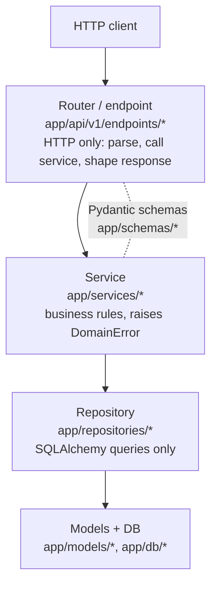
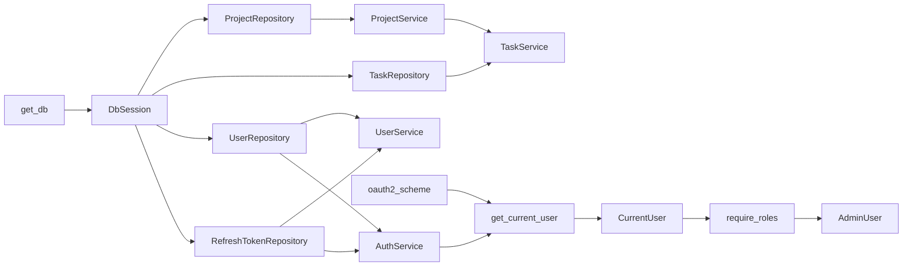
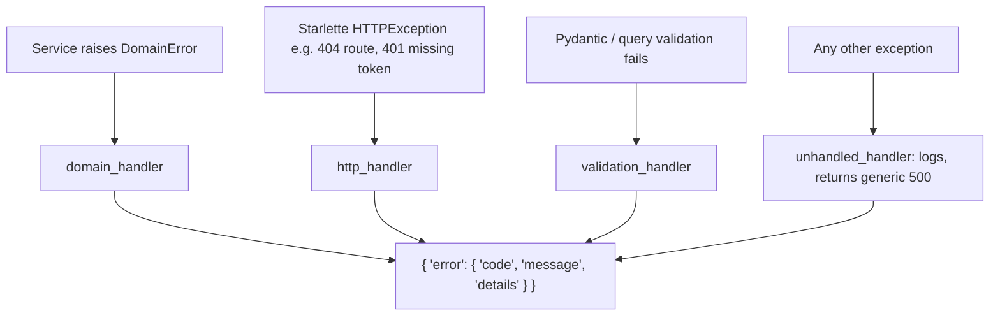

# Architecture

## 1. The big idea: four layers

Each layer has one job and may only call the layer directly below it.



| Layer | Knows about | Must NOT know about |
|---|---|---|
| Router | FastAPI, schemas, services | SQL, sessions, business rules |
| Service | repositories, domain errors, schemas as input DTOs | HTTP status codes, `Request`, FastAPI |
| Repository | SQLAlchemy, models | business rules, who the user is |
| Model | table structure | everything else |

Why bother? Business rules (e.g. "a user may only touch their own tasks", "reusing a rotated refresh token revokes every session") live in one testable place, and swapping the database or the web framework touches only one layer.

## 2. Request lifecycle

```mermaid
sequenceDiagram
    participant Cl as Client
    participant MW as Middleware (CORS, request-id)
    participant Rt as Router (tasks.py)
    participant Dp as Dependencies (api/deps.py)
    participant Sv as TaskService
    participant Rp as TaskRepository
    participant DB as Database
    Cl->>MW: GET /api/v1/tasks?status=todo (Bearer token)
    MW->>Rt: adds X-Request-ID, starts timer
    Rt->>Dp: resolve CurrentUser, TaskService, Pagination
    Dp->>DB: get_db opens ONE session; decode JWT; load user
    Rt->>Sv: list(user, params, filters)
    Sv->>Rp: list(owner_id scope, filters)
    Rp->>DB: SELECT ... WHERE owner_id=? AND status=? LIMIT ?
    DB-->>Rp: rows
    Rp-->>Sv: (items, total)
    Sv-->>Rt: (items, total)
    Rt-->>MW: Page[TaskRead] (validated by response_model)
    Note over Dp,DB: after the response is built, get_db COMMITS (or rolls back on error)
    MW-->>Cl: 200 + X-Request-ID + X-Process-Time-ms
```

## 3. Folder tree

```
app/
  main.py                      App factory (create_app), lifespan, CORS, middleware, exception handlers
  core/
    config.py                  pydantic-settings `Settings` (env / .env), validators (SECRET_KEY >= 32 chars, no CORS "*")
    security.py                bcrypt hashing, JWT create/decode (access + refresh), token hashing
    exceptions.py              DomainError hierarchy: NotFound, Conflict, Unauthorized, Forbidden, ValidationFailed, ServiceUnavailable
    middleware.py              Adds X-Request-ID and X-Process-Time-ms, logs each request
    logging.py                 Logging setup
  db/
    base.py                    DeclarativeBase + TimestampMixin (created_at/updated_at)
    session.py                 make_engine, SessionFactory, get_db (unit of work)
  models/
    user.py                    User + Role enum
    refresh_token.py           Stored (hashed) refresh tokens
    project.py                 Project (owned by user)
    task.py                    Task + TaskStatus/TaskPriority enums
    __init__.py                Imports every model so metadata knows all tables
  schemas/
    common.py                  PageParams, generic Page[T], ErrorResponse
    user.py / auth.py          Email/Password validators, request & response models
    project.py / task.py       Create/Update/Read models, sort enums
  repositories/
    base.py                    BaseRepository (get/add/save/delete/paginate), LIKE escaping
    user.py refresh_token.py project.py task.py   Domain-specific queries
  services/
    auth_service.py            register, login, refresh rotation, logout, change password, token -> user
    user_service.py            profile update, admin user management
    project_service.py         ownership rules (read scope vs write scope)
    task_service.py            task rules, filters/sort delegation
  api/
    deps.py                    DI wiring: DbSession, services, CurrentUser, require_roles, Pagination
    v1/router.py               Aggregates endpoint routers
    v1/endpoints/              health.py auth.py users.py projects.py tasks.py
tests/                         conftest.py + test_auth/users/projects/tasks/health
docs/                          This documentation
```

## 4. Dependency injection wiring

FastAPI resolves a tree of `Depends` per request. Everything in the tree shares **one** `AsyncSession` because `get_db` is cached per request.



Endpoints declare what they need using `Annotated` aliases from `app/api/deps.py`:

```python
@router.get("", response_model=Page[TaskRead])
async def list_tasks(user: CurrentUser, svc: TaskServiceDep, params: Pagination, ...):
```

In tests, one override (`app.dependency_overrides[get_db] = ...`) swaps the whole database for an in-memory one.

## 5. Unit of work (transactions)

`get_db` (app/db/session.py) is the unit of work: **one request = one session = one transaction**.

```python
async with SessionFactory() as session:
    try:
        yield session          # the endpoint + service + repositories run here
        await session.commit() # success -> commit everything at once
    except Exception:
        await session.rollback()
        raise
```

Repositories call `flush()` (send SQL, get IDs) but never `commit()`. So a service that does several writes is automatically atomic. Exception: `AuthService.refresh` commits explicitly when it detects token reuse, because it then raises an error (which would roll back the revocation otherwise). See AUTH.md.

Note: because the commit happens *after* the endpoint returns, a failing commit would surface as a 500 after the handler ran. That is acceptable here; for stricter semantics commit inside the service.

## 6. Error handling flow



| Source | Status | `code` |
|---|---|---|
| `NotFound` | 404 | `not_found` |
| `Conflict` | 409 | `conflict` |
| `Unauthorized` | 401 (+ `WWW-Authenticate: Bearer`) | `unauthorized` |
| `Forbidden` | 403 | `forbidden` |
| `ServiceUnavailable` | 503 | `service_unavailable` |
| request validation | 422 | `validation_error` (details = list of `{field, message, type}`) |
| unexpected | 500 | `internal_error` (no internals leaked) |

Services never import FastAPI; they raise plain Python exceptions, and `main.py` is the single place that maps them to HTTP.

## 7. Cross-cutting pieces

- **Middleware**: `RequestContextMiddleware` (request id + timing) and `CORSMiddleware` (explicit origins from settings).
- **Lifespan**: creates tables (`create_all`) and optionally bootstraps the first admin from `FIRST_ADMIN_*`, disposes the engine on shutdown.
- **Settings**: `app/core/config.py`, cached singleton `settings`.
- **No lazy loading**: models define no relationships, so async code can never trigger an implicit lazy load. If you add relationships, use `lazy="raise"` and explicit `selectinload`.

## 8. Design trade-offs

| Decision | Benefit | Cost / alternative |
|---|---|---|
| Services + repositories | Testable rules, swappable persistence | More files than "queries in routers"; for tiny CRUD apps it is overkill |
| Commit in `get_db` | Atomic requests, services stay simple | Commit errors surface late; reuse-detection needs an explicit commit |
| Ownership in the query (`WHERE owner_id=?`) | Others' data is indistinguishable from missing (404, no ID enumeration) | Admin "read all" needs an `owner_id=None` branch |
| Admin may read all but edit only own | Least privilege | Admin cannot fix users' data via the API |
| No ORM relationships | No lazy-load pitfalls, simple | Joins must be written by hand when needed |
| `create_all` in lifespan | Zero setup | No schema evolution; use Alembic for real projects |
| Domain exceptions instead of `HTTPException` in services | Services are framework-free | One more mapping layer |
| BaseHTTPMiddleware | Easy to read | Slightly slower than pure ASGI middleware |
