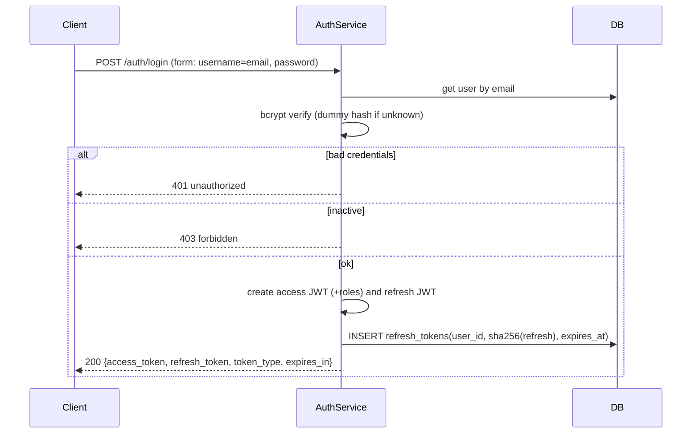
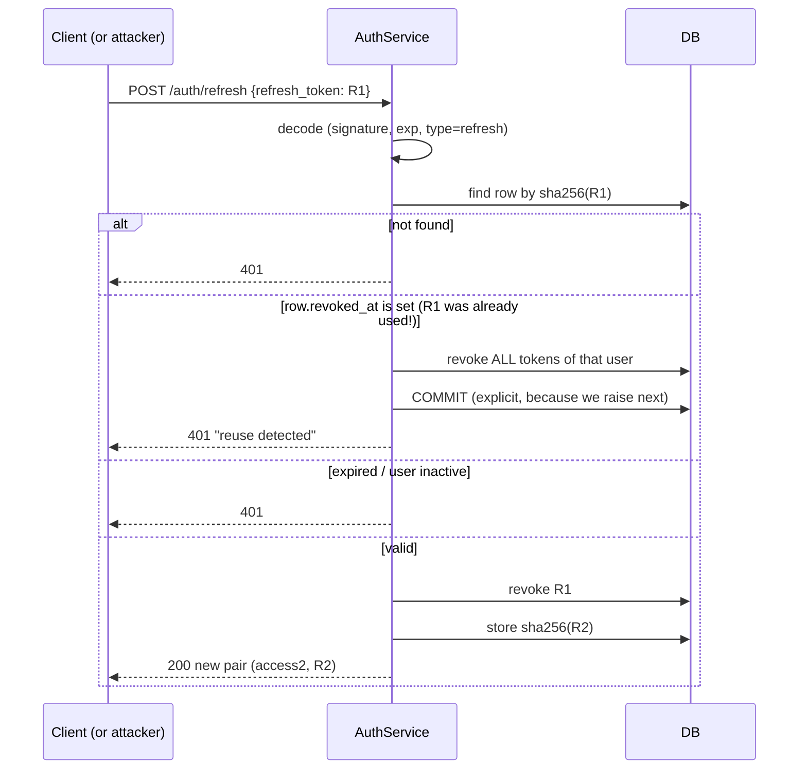

# Authentication and authorization

Code: `app/core/security.py` (crypto), `app/services/auth_service.py` (flows), `app/api/deps.py` (current user, roles), `app/api/v1/endpoints/auth.py` (HTTP).

## 1. Passwords

- Hashed with **bcrypt** (salted, slow on purpose). Cost = `BCRYPT_ROUNDS` (default 12; tests use 4 for speed).
- bcrypt only reads the first 72 bytes, so the password policy rejects longer passwords instead of silently truncating.
- Policy (Pydantic validator in `schemas/user.py`): at least 10 chars, at most 72 bytes, contains a lowercase letter, an uppercase letter and a digit. The e-mail is lowercased and trimmed.
- Login uses a constant-ish time path: if the e-mail is unknown we still verify against a dummy hash, and we return the same message for "unknown e-mail" and "wrong password" (no user enumeration).

## 2. Two kinds of token

Both are signed JWTs (HS256, `SECRET_KEY`), but they differ:

| | Access token | Refresh token |
|---|---|---|
| Purpose | Authorize API calls | Get a new pair of tokens |
| Lifetime | `ACCESS_TOKEN_MINUTES` (15) | `REFRESH_TOKEN_DAYS` (7) |
| Sent to | every protected endpoint (`Authorization: Bearer`) | only `/auth/refresh` and `/auth/logout` |
| Stored server-side | no (stateless) | yes, **SHA-256 hashed** in `refresh_tokens` |
| Revocable | only by expiry (or user deactivation, see below) | yes, instantly |

Claims:

| Claim | Meaning | Access | Refresh |
|---|---|---|---|
| `sub` | user id (string) | yes | yes |
| `type` | `"access"` or `"refresh"` | yes | yes |
| `iat` / `exp` | issued-at / expiry | yes | yes |
| `jti` | unique token id | yes | yes |
| `roles` | e.g. `["user"]` | yes | no |

`decode_token(token, expected_type)` checks signature, expiry, that all required claims exist, and that `type` matches. An access token sent to `/auth/refresh` or a refresh token sent as a Bearer header is rejected with 401 ("Wrong token type").

Why hash refresh tokens? If the database leaks, the attacker gets hashes, not usable tokens (same reason passwords are hashed). A fast hash is fine because tokens are high-entropy random strings, not guessable passwords.

## 3. Login



## 4. Refresh with rotation and reuse detection

Every refresh token is **single use**. Using it returns a brand-new pair and revokes the old token.



Why reuse detection? If an attacker steals R1 and uses it first, the real client's next refresh with R1 looks like reuse. We cannot tell who is who, so we revoke the whole family and force a fresh login. The test `test_refresh_rotation_and_reuse_detection` demonstrates exactly this.

## 5. Logout

- `POST /auth/logout {refresh_token}`: revokes that token (idempotent; unknown/already revoked is still 204). The access token stays valid until it expires (max 15 min) because it is stateless.
- `POST /auth/logout-all` (Bearer): revokes every refresh token of the user.
- `POST /auth/change-password`: verifies the current password, stores the new hash and revokes all refresh tokens.
- Deactivating a user (admin) revokes all their refresh tokens; their existing access token is rejected with 403 on the next call because `get_current_user` loads the user from the DB each time.

## 6. Roles and permissions

`User.role` is `user` or `admin`. Admins cannot be created by self-registration (always `user`); use `FIRST_ADMIN_EMAIL`/`FIRST_ADMIN_PASSWORD` at startup, or promote via `PATCH /users/{id}` as an existing admin.

Guard: `require_roles(Role.ADMIN)` in `app/api/deps.py` (alias `AdminUser`).

```python
@router.get("", response_model=Page[UserRead])
async def list_users(_: AdminUser, ...): ...
```

The role is read from the **database** on every request, not trusted from the token's `roles` claim, so demotion/deactivation takes effect immediately. The claim exists for clients and for services that cannot reach the DB.

| Capability | user | admin |
|---|---|---|
| Own profile, own projects/tasks (CRUD) | yes | yes |
| Read others' projects/tasks | no (404) | yes (read-only) |
| Modify others' projects/tasks | no (404) | no (404) |
| List/get/update/deactivate users | no (403) | yes (not themselves) |

## 7. Security decisions

- Same error for unknown e-mail vs wrong password; foreign resources return 404 not 403.
- `SECRET_KEY` must be >= 32 chars (validated at startup).
- CORS: explicit origins only, wildcard rejected.
- LIKE search input is escaped (`%`, `_`).
- Token `type` separation prevents refresh/access confusion.
- Error responses never include stack traces.

## 8. Known limitations (honest list)

- **No login rate limiting or account lockout.** Put a rate limiter in front (reverse proxy, or add `slowapi`/Redis counters) before exposing this publicly.
- Access tokens cannot be revoked before expiry (except via the user-active check). Keep them short.
- HS256 with a shared secret; use RS256/EdDSA if other services must verify tokens.
- No e-mail verification, password reset or MFA.
- Refresh rotation is not race-proof: two concurrent refreshes with the same token could both pass the check on SQLite. Postgres needs `SELECT ... FOR UPDATE` (or a conditional `UPDATE ... WHERE revoked_at IS NULL`) for strictness.
- Expired refresh-token rows are never purged; run a periodic cleanup job.
- Tokens are returned in JSON; browsers apps may prefer an HttpOnly cookie for the refresh token.
