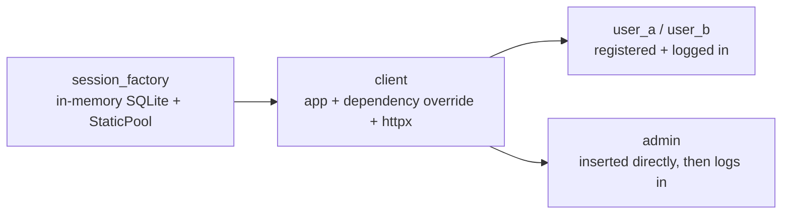

# Testing

Run: `uv run pytest -q` (config in `pyproject.toml`: `asyncio_mode = "auto"`, so `async def test_*` just works).

## Strategy

Tests are **API-level integration tests**: they call real endpoints through `httpx.AsyncClient` + `ASGITransport` (no network, no server process) against an in-memory SQLite database. This exercises routers, services, repositories and SQL together, which is where the interesting rules (ownership, rotation, filters) live.

| File | Covers |
|---|---|
| `test_auth.py` | register/login/me, password policy (422), 409 duplicate, refresh rotation + reuse detection, access-vs-refresh misuse, claims, expired/forged tokens, logout, logout-all, change password, deactivated user |
| `test_users.py` | `/users/me`, 403 for non-admins, admin list/search/pagination/filter, role & active updates, self-demotion 409, invalid role 422 |
| `test_projects.py` | CRUD, validation, pagination/search/archived filter, LIKE escaping, user isolation, admin read-all-but-no-write, cascade delete |
| `test_tasks.py` | CRUD, PATCH `exclude_unset` semantics, validation, foreign project 404, isolation, admin read, filters + sort + pagination, invalid params, old paths gone |
| `test_health.py` | liveness, readiness, request-id header, 404 envelope |

## Fixtures (`tests/conftest.py`)



- `session_factory`: new engine per test with `StaticPool` (all connections share one in-memory DB; without it each connection would see an empty DB), tables created fresh, disposed afterwards. Tests are fully isolated.
- `client`: builds a fresh app via `create_app()`, overrides `get_db` to use the test factory (same commit/rollback logic as production), and uses `ASGITransport(raise_app_exceptions=False)` so unhandled errors become 500 responses like in production.
- `user_a`, `user_b`, `admin`: dicts with `headers` (`{"Authorization": "Bearer ..."}`), `tokens` and (users) `user`.
- Helpers: `register`, `login`, `make_user`, `create_project`, `create_task`, constants `API`, `PASSWORD`.
- `conftest.py` sets `BCRYPT_ROUNDS=4` **before importing the app** so hashing is fast.

## Adding a test

```python
# tests/test_projects.py
from .conftest import API, create_project

async def test_rename_project(client, user_a):
    p = await create_project(client, user_a["headers"], "Old")
    r = await client.patch(f"{API}/projects/{p['id']}", json={"name": "New"}, headers=user_a["headers"])
    assert r.status_code == 200
    assert r.json()["name"] == "New"
```

Checklist per endpoint: happy path, 401 without token, 404 for another user's data, 422 for bad input, 403/409 where relevant.

## Tips

- Need a different actor? Use `make_user(client, "c@example.com")`.
- Test a rule without HTTP? Instantiate the service with repositories on a session from `session_factory`.
- Failing with `MissingGreenlet`? Something lazy-loaded; load it explicitly in the repository.
